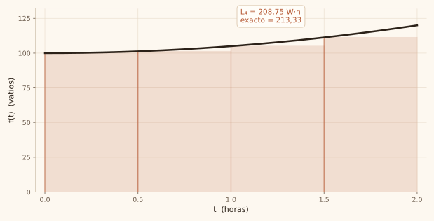

# De la potencia a la energía

> La potencia es un punto en el tiempo. La energía es el área debajo de esa curva.

::: objetivo
Explicar por qué $120$ vatios no son $120$ vatios-hora, estimar la energía de una bomba con sumas de Riemann y justificar cuándo la aproximación es suficientemente buena para decidir.
:::

::: prerequisito
Saber multiplicar, leer una tabla y entender que una hora tiene 60 minutos. Si puedes decir cuánto cuesta mantener encendido un bombillo de 100 W durante 2 horas, ya tienes lo necesario.
:::

## El problema del agricultor {concepto}

Un agricultor riega con una bomba eléctrica durante **2 horas** y quiere saber cuánta energía gasta, porque la luz se la cobran.

Si la bomba gastara siempre lo mismo, sería una multiplicación. Pero no: arranca en 100 vatios y va subiendo hasta 120.

::: analogia
Un carro a 120 km/h no ha recorrido 120 km: ha ido a esa velocidad. Recorrerá 120 km solo si mantiene ese ritmo una hora. Con la bomba pasa igual: 120 vatios es la rapidez con que consume, no lo que consumió.
:::

## La función que describe la bomba {concepto}

$$f(t) = 100 + 5t^2$$

En la fórmula, $t$ son horas y el resultado son **vatios**:

| Tiempo | Potencia |
| ---: | ---: |
| 0 h | 100 W |
| 1 h | 105 W |
| 2 h | 120 W |

::: error
Decir «gastó 120 porque a las 2 horas tenía 120 vatios» es el error más común. El 120 es la velocidad de consumo en ese instante; la energía es el acumulado.
:::

## Partir el tiempo en pedazos {concepto}

Cortamos las 2 horas en $n$ pedazos de ancho $\Delta t = 2/n$. Cada pedazo es un rectángulo: ancho $\Delta t$, alto $f(t_i)$.

$$L_n = \sum_{i=0}^{n-1} f(t_i)\,\Delta t$$

::: ejemplo
Con 4 pedazos de media hora: 100; 101,25; 105 y 111,25 vatios. Sumados dan 417,5. Multiplicados por 0,5 h dan **208,75 W·h**. Falta un paso: ¿cuánto daría si usaras el extremo derecho en vez del izquierdo?
:::

## De dónde salió esta idea {historia}

En 1675 Leibniz inventó el símbolo $\int$: una «S» alargada de *summa*, suma. La idea era literal: integrar es sumar pedazos infinitamente pequeños.

En 1823 Cauchy le puso rigor y definió la integral como el límite de una suma. Treinta años después, en 1854, Bernhard Riemann generalizó esa definición en su conferencia de habilitación en Gotinga: en vez de exigir funciones continuas, aceptó cualquier función cuyas sumas converjan. Esa es la suma que hoy lleva su nombre.

::: nota
Durante casi dos siglos el símbolo y la idea fueron los mismos: sumar pedazos. Laplace ya calculaba volúmenes así en 1812. Lo que cambió después fue el rigor, no la intuición.
:::

## Tres maneras de aproximar lo mismo {practica}

::: enfoques
- **Rectángulos por izquierda** — usan la altura del inicio de cada pedazo. Subestiman si la función crece.
- **Trapecios** — unen los extremos con una recta. Mucho más preciso con pocos pedazos.
- **Simpson** — ajusta una parábola cada dos pedazos. Con 20 pedazos el error ya es microscópico.
:::

## Cómo llegar a la idea de convergencia {practica}

| Pedazos | Ancho | Estimación | Error |
| ---: | ---: | ---: | ---: |
| 1 | 2 h | 200,00 | 13,33 |
| 4 | 30 min | 208,75 | 4,58 |
| 20 | 6 min | 212,35 | 0,98 |
| 100 | 72 s | 213,13 | 0,20 |
| exacto | — | 213,33 | 0 |

::: llegar
- Observa: con 1 pedazo faltan 13,33 para el exacto; con 4 faltan 4,58; con 20, 0,98; con 100, 0,20.
- Compara: la estimación sube y el error baja, pero no de cualquier forma: al pasar de 4 a 20 pedazos (×5) el error se divide por 4,7; al pasar de 20 a 100 (×5) se divide por 4,9.
- Cuantifica: el error se comporta como $1/n$. Duplicar los pedazos reduce el error a la mitad; multiplicar por 10 lo reduce a la décima parte.
- Nombra: cuando al aumentar $n$ el error tiende a cero, se dice que la suma **converge** a la integral definida. Ese límite es, literalmente, la integral.
- Verifica: con 100 pedazos el error es 0,20 sobre 213,33, es decir 0,09 %; con 20 pedazos es 0,46 %. Los números confirman el patrón.
- Decide: para presupuestar alcanza con 20 pedazos; para facturar conviene 100 o un método de orden superior como Simpson.
:::

::: nota
La convergencia no se supone: se mide. Si el error no bajara al aumentar $n$, la suma no serviría para decidir nada.
:::

## Procedimiento para resolver con cuatro pedazos {practica}

::: pasos
1. Calcula el ancho de cada pedazo: $\Delta t = 2/4 = 0{,}5$ h.
2. Evalúa la potencia en el extremo izquierdo de cada pedazo: 100; 101,25; 105 y 111,25 W.
3. Suma las cuatro alturas: 417,5 W.
4. Multiplica por el ancho: $417{,}5 \times 0{,}5 = 208{,}75$ W·h.
5. Compara con el valor exacto y reporta el error: $213{,}33 - 208{,}75 = 4{,}58$ W·h, un 2,15 %.
:::

## Comprobación con la integral {practica}

$$ \int_0^2 (100 + 5t^2)\,dt = \left[100t + \frac{5}{3}t^3\right]_0^2 = 200 + \frac{40}{3} = 213{,}33 $$

## Practica antes de seguir {practica}

Q: ¿Qué unidades tiene $f(2)$?
R: Vatios. Es la potencia en el instante $t = 2$, no una energía.

Q: ¿Por qué la suma con $n = 1$ da 200 y no 213,33?
R: Porque usa la potencia del arranque (100 W) durante las 2 horas completas, y la bomba en realidad sube hasta 120 W.

Q: ¿Qué pasa con el error cuando duplicas el número de pedazos?
R: Se reduce aproximadamente a la mitad: 13,33 → 4,58 → 0,98 → 0,20.

Q: ¿La suma se acerca por arriba o por abajo del valor exacto?
R: Por abajo, porque tomamos la altura en el extremo izquierdo y la función es creciente. Con el extremo derecho se acercaría por arriba.

Q: ¿Qué cambiaría si la bomba arrancara en 120 y bajara a 100?
R: La suma por izquierda pasaría a sobreestimar, porque el primer valor sería el más alto. El método no cambia; cambia el signo del error.

## Plan para no olvidarlo {practica}

::: plan
- Hoy — Leer esta guía y responder las preguntas sin mirar.
- Día 2 — Repetir las preguntas y rehacer el ejemplo de 4 pedazos.
- Día 5 — Explicarlo en voz alta a alguien en 3 minutos.
- Día 12 — Calcular el caso de la bomba apagada a la hora 1.
- Día 25 — Resolver un problema nuevo de otro contexto sin mirar la guía.
:::

::: transferencia
Explica por qué un plan de datos móviles «ilimitado con reducción» se parece a esta suma.
Calcula el consumo de una app que sube su uso de CPU de 100 a 120 unidades en 2 horas.
Escribe la suma para 8 pedazos y compárala con la tabla.
Busca en tu carrera un caso donde tengas la tasa y necesites el acumulado.
:::
