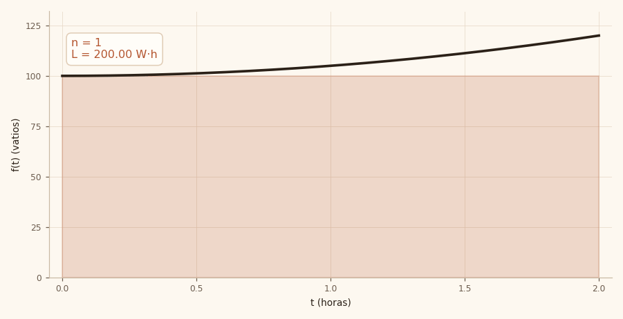

# La cuenta de la luz que no cuadraba

> La potencia es la rapidez con que gastas. La energía es lo que gastaste.

::: objetivo
Que puedas leer la factura de una bomba, entender por qué el número del medidor no es el que la intuición sugiere, y estimar el consumo real con una suma que se puede hacer a mano.
:::

::: prerequisito
Multiplicar, dividir y leer una tabla. Si sabes que un bombillo de 100 W encendido dos horas gasta 200 vatios-hora, ya tienes la mitad del camino.
:::

## El territorio: las palabras que vamos a usar {dominio}

Casi todas las confusiones de este tema son de vocabulario, así que conviene fijarlo antes de tocar números.

| Término | Qué es | Unidad |
| --- | --- | --- |
| Tasa | La rapidez con que cambia algo en un instante: la derivada. | W |
| Acumulado | Lo que se junta al sumar la tasa durante un intervalo: la integral. | W·h |
| Partición | Los cortes $a=t_0<t_1<\dots<t_n=b$ que dividen el intervalo. | h |
| Subintervalo | El pedazo entre dos cortes consecutivos. | h |
| Ancho $\Delta t_i$ | La duración del subintervalo: $t_i-t_{i-1}$. | h |
| Punto de muestra | El instante dentro del subintervalo donde se mide la altura. | h |
| Suma de Riemann | La suma de ancho por altura: $\sum f(t_i)\,\Delta t_i$. | W·h |

La palabra que más se malinterpreta es **ancho**: no es el ancho de un dibujo, es cuánto tiempo cubre cada subintervalo. Y «área» es la representación geométrica, no la magnitud: lo que se acumula depende de las unidades de la tasa.

## La escena {problema}

Son las cinco y cuarenta de la mañana en Suesca y el agua todavía está fría. El agricultor abre la válvula, la bomba carraspea una vez y arranca. Dos horas después la apaga, y esa noche, cuando llega la factura, hace la cuenta que hacemos todos: «ciento veinte vatios por dos horas, doscientos cuarenta».

El recibo dice otra cosa. Y no es que la empresa cobre de más: lo que falla es la cuenta.

La bomba no gastó 120 vatios todo el tiempo. A las seis de la mañana apenas llegaba a 100; los 120 los tocó justo cuando el sol ya estaba alto y el motor llevaba rato trabajando. Multiplicar por el número más grande es como calcular el precio de la plaza por el artículo más caro del mercado: el resultado existe, pero no es el que buscas.

Y aquí está el nudo: no hay un solo número que multiplicar, porque el consumo cambia a cada rato. La pregunta «¿cuánto gastó?» no se responde con una multiplicación. Se responde sumando.

## La bomba que se calienta {concepto}

El ejercicio da la potencia como una fórmula: $f(t) = 100 + 5t^2$. Léela como una descripción, no como un obstáculo. El 100 es lo que consume recién encendida. El $5t^2$ es lo que se le va sumando con el trabajo: primero poco, después más, porque el cuadrado crece cada vez más rápido.

A la hora uno aporta cinco vatios; a la hora dos, veinte. Por eso la curva se empina al final.

| Hora | Cuenta | Potencia |
| ---: | --- | ---: |
| 0 h | $100 + 5(0)^2$ | 100 W |
| 1 h | $100 + 5(1)^2$ | 105 W |
| 2 h | $100 + 5(2)^2$ | 120 W |

::: error
«Gastó 120 porque a las dos horas marcaba 120». Ese 120 es la rapidez con la que consumía en ese instante, no lo que consumió. Es la diferencia entre ir a 120 km/h y haber recorrido 120 km.
:::

## Los pedazos y su ancho {concepto}

Para sumar hay que partir. Imagina que las dos horas son un pan y lo cortas en rebanadas. Cada rebanada cubre un rato, y a ese rato le llamamos **ancho**:

$$\Delta t = \frac{2}{n}$$

Cuatro rebanadas son de media hora. Cien rebanadas son de 72 segundos, tan finas que dentro de cada una la potencia casi no cambia. Esa es toda la gracia: si el pedazo es pequeño, la potencia se puede tratar como si fuera constante.

El ancho es también lo que convierte vatios en vatios-hora. Un vatio suelto no dice nada; hay que decir cuánto tiempo estuvo encendido. Multiplicar la potencia por el ancho es exactamente ese «cuánto tiempo».

## Dos maneras de mirar lo mismo {miradas}

La escena del agricultor y la fórmula dicen lo mismo desde dos orillas. Desde la física, el área bajo la curva es la energía que entró al motor: cada rectángulo es un rato de consumo. Desde la geometría, es simplemente el área de una región limitada por una curva, y el método no sabe de vatios.

Esa doble lectura es la que vuelve útil el concepto: lo que aquí se mide en vatios-hora, en otra parte se mide en metros recorridos, en litros llenados o en pesos cobrados. El dibujo no cambia; cambia la unidad.

Y hay una tercera mirada, la del que factura: para él no importa el valor exacto sino cuánto se puede equivocar sin que la cuenta quede mal. De ahí sale la pregunta por el error, que aparece más adelante.

## El primer intento: un solo pedazo {concepto}

Supongamos que no cortamos nada: una sola rebanada de dos horas. Tomamos la potencia del arranque y la estiramos hasta el final.

::: desglose
## Un pedazo → 200 W·h
- Ancho: 2 h ÷ 1 = 2 h
- Potencia al inicio: f(0) = 100 + 5(0)² = 100 W
- Energía: 100 W × 2 h = 200 W·h
- Error: 213,33 − 200 = 13,33 W·h
- Lectura: la bomba terminó gastando más de 100, así que esta cuenta se queda corta
:::

Doscientos es el piso de la estimación. No es la respuesta, pero sirve: cualquier cálculo decente tiene que quedar por encima.

## Cortar más fino {concepto}

Cada rebanada es un rectángulo: ancho es el tiempo, altura es la potencia al inicio. La suma de todos los rectángulos es la energía estimada.

$$L_n = \sum_{i=0}^{n-1} f(t_i)\,\Delta t$$

Con cuatro pedazos ya se ve el escalón. Con cien, la suma de escalones se confunde con la curva. El GIF de arriba lo muestra en cuatro segundos: mira cómo el borde superior de los rectángulos se pega a la línea negra a medida que $n$ crece.

## De dónde salió esta idea {historia}

En 1854, un joven de 28 años llamado Bernhard Riemann tenía que dar una clase para poder enseñar en Gotinga. Podía escoger entre tres temas y eligió el que menos le convenía —las series trigonométricas— porque era el único que no había preparado. Se encerró a resolverlo y de ahí salió, sin proponérselo, su definición de integral.

El problema era concreto: Cauchy había definido la integral como límite de sumas en 1823, pero exigiendo que la función fuera continua, sin saltos. Treinta años antes, Fourier había demostrado que casi cualquier función podía escribirse como suma de senos y cosenos, y esas funciones saltan, se rompen y se disparan al infinito. La herramienta de Cauchy no servía para las funciones de Fourier.

Riemann cambió una sola cosa: en vez de exigir continuidad, exigió que las sumas convergieran. Si al hacer los pedazos cada vez más pequeños la suma se estabiliza, hay integral; si no, no la hay. La integral dejó de ser una fórmula y se volvió una prueba de comportamiento.

La idea de sumar pedazos era antiquísima: Arquímedes calculaba áreas así en el siglo III antes de Cristo, y Leibniz había inventado el símbolo $\int$ en 1675 como una «S» alargada de *summa*. Lo que Riemann agregó fue el criterio para saber cuándo esa suma vale. Por eso lleva su nombre y no el de Leibniz.

## Cómo llegamos a llamarlo convergencia {llegar}

Mira la tabla sin creerle nada. Solo léela.

| Pedazos | Ancho | Estimación | Error |
| ---: | ---: | ---: | ---: |
| 1 | 2 h | 200,00 | 13,33 |
| 4 | 30 min | 208,75 | 4,58 |
| 20 | 6 min | 212,35 | 0,98 |
| 100 | 72 s | 213,13 | 0,20 |
| exacto | — | 213,33 | 0 |

::: llegar
- Observa: con 1 pedazo faltan 13,33; con 4, 4,58; con 20, 0,98; con 100, 0,20.
- Compara: de 4 a 20 el error se divide por 4,7; de 20 a 100, por 4,9. Multiplicar los pedazos por cinco divide el error por casi cinco.
- Cuantifica: el error se comporta como $1/n$. Duplicar los pedazos lo reduce a la mitad.
- Nombra: cuando al crecer $n$ el error tiende a cero, la suma **converge** a la integral definida.
- Verifica: con 100 pedazos el error es 0,09 %; con 20, 0,46 %. Los números sostienen el nombre.
- Decide: con 20 pedazos se presupuesta; para facturar, 100 o Simpson.
:::

Y si quieres ver la aritmética de cada fila, se abre aquí:

::: desglose
## Cuatro pedazos → 208,75 W·h
- Ancho: 2 h ÷ 4 = 0,5 h
- Potencias: f(0) = 100; f(0,5) = 101,25; f(1) = 105; f(1,5) = 111,25
- Suma: 100 + 101,25 + 105 + 111,25 = 417,5 W
- Energía: 417,5 × 0,5 = 208,75 W·h
- Error: 4,58 W·h (2,15 %)

## Veinte pedazos → 212,35 W·h
- Ancho: 0,1 h (6 minutos)
- Suma de las 20 alturas: 2.123,5 W
- Energía: 2.123,5 × 0,1 = 212,35 W·h
- Error: 0,98 W·h (0,46 %)

## Cien pedazos → 213,13 W·h
- Ancho: 0,02 h (72 segundos)
- Suma de las 100 alturas: 10.656,7 W
- Energía: 10.656,7 × 0,02 = 213,13 W·h
- Error: 0,20 W·h (0,09 %)
:::

## Tres formas de hacer la misma suma {metodos}

::: enfoques
- **Rectángulos por izquierda** — la altura se toma al inicio de cada pedazo. Simple, y subestima cuando la función crece. Es la del ejercicio.
- **Trapecios** — se une el inicio y el final de cada pedazo con una recta. Con la misma información el error cae de 2,15 % a 0,03 %.
- **Simpson** — una parábola cada dos pedazos. Con 20 pedazos el error es de millonésimas: se usa para facturar, no para decidir.
:::

## El procedimiento, en orden {aplicacion}

::: pasos
1. Calcula el ancho: $\Delta t = 2/4 = 0{,}5$ h.
2. Evalúa la potencia al inicio de cada pedazo: 100; 101,25; 105; 111,25 W.
3. Suma las alturas: 417,5 W.
4. Multiplica por el ancho: $417{,}5 \times 0{,}5 = 208{,}75$ W·h.
5. Compara con el exacto: error de 4,58 W·h, un 2,15 %.
:::

## Ponte a prueba {practica}

Q: ¿Qué unidades tiene $f(2)$?
R: Vatios. Es la potencia en ese instante, no una energía.

Q: ¿Por qué un solo pedazo da 200 y no 213,33?
R: Porque estira la potencia del arranque (100 W) durante dos horas. La bomba terminó en 120, así que la cuenta se queda corta.

Q: ¿Qué es el ancho, en una frase?
R: El tiempo que cubre cada pedazo: las dos horas divididas entre el número de pedazos.

Q: ¿Qué le pasa al error si duplicas los pedazos?
R: Se reduce a la mitad, porque se comporta como 1/n.

Q: ¿La suma se acerca por arriba o por abajo?
R: Por abajo, porque toma la altura en el extremo izquierdo y la función crece. Por la derecha se acercaría por arriba.

Q: ¿Y si la bomba arrancara en 120 y bajara a 100?
R: La suma por izquierda pasaría a sobreestimar. El método no cambia; cambia el signo del error.

## Para que no se te olvide {cierre}

::: plan
- Hoy — Leer y responder las preguntas sin mirar.
- Día 2 — Rehacer el desglose de cuatro pedazos de memoria.
- Día 5 — Explicarlo en tres minutos a alguien que no sepa del tema.
- Día 12 — Calcular el caso de una bomba que se apaga a la hora 1.
- Día 25 — Resolverlo en otro contexto sin volver a la guía.
:::

::: transferencia
Un plan de datos «ilimitado con reducción» cambia de precio por tramos: es la misma suma, con unidades distintas.
Una app que sube su uso de CPU de 100 a 120 en dos horas consume energía; el cálculo es idéntico.
Escribe la suma para ocho pedazos y compárala con la tabla.
Busca en tu carrera un caso donde tengas la tasa y necesites el acumulado.
:::
